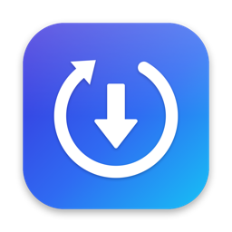
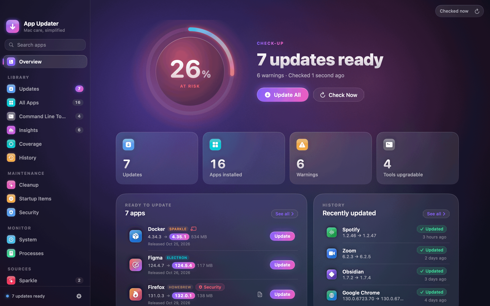
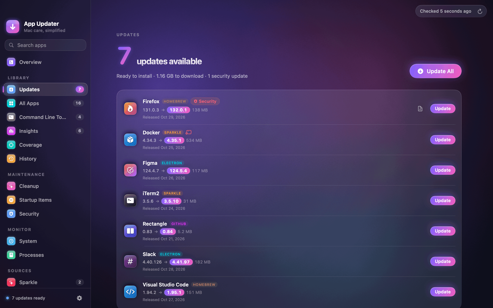
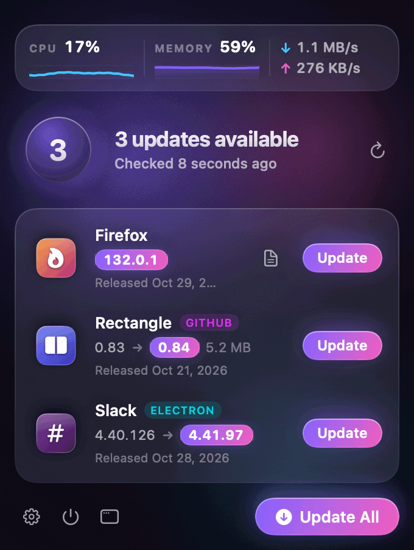
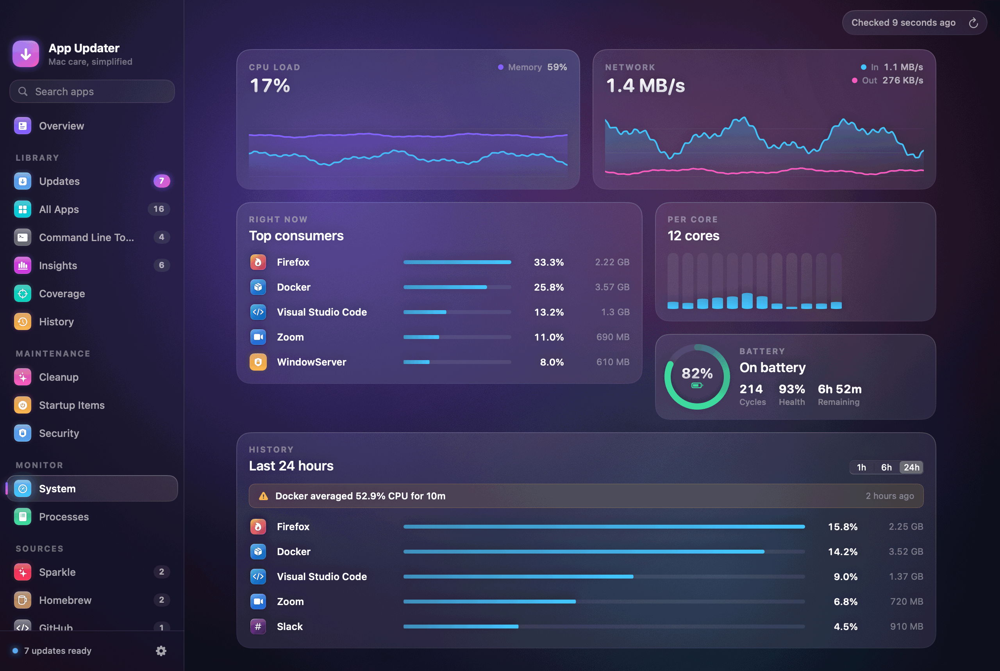
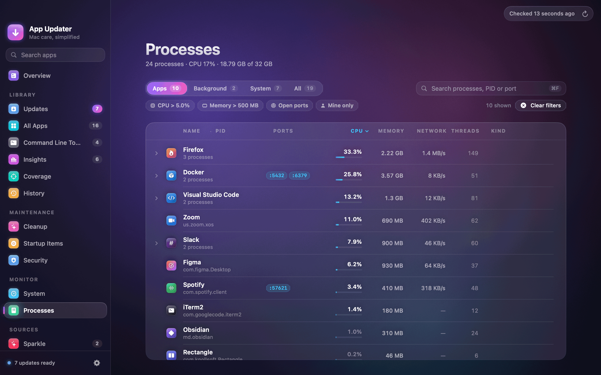
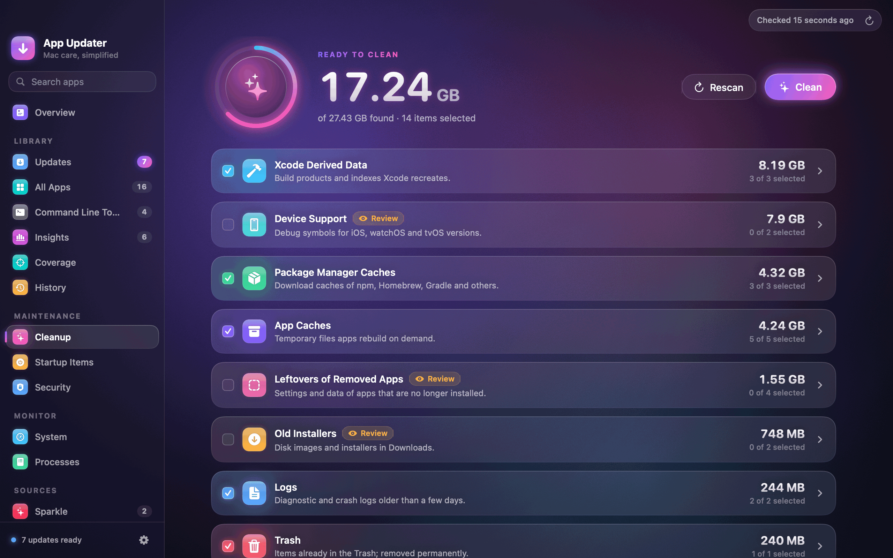
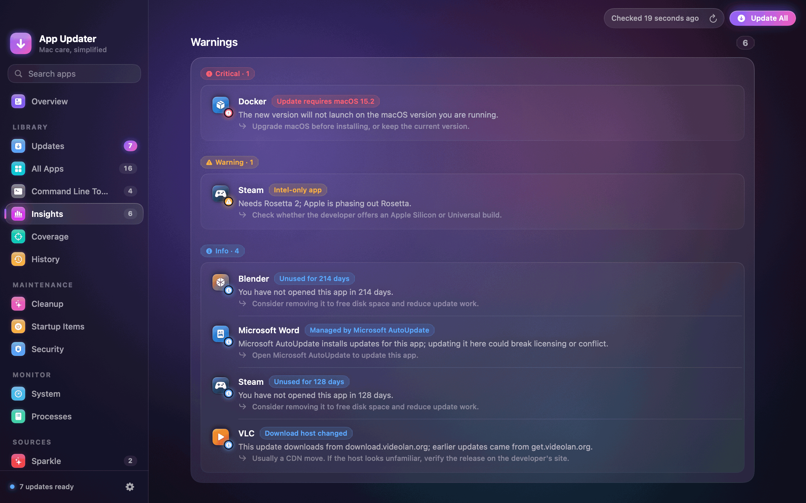

<p align="center">
  
</p>

<h1 align="center">App Updater</h1>

<p align="center">
  <b>Every app on your Mac, up to date and checked before it installs.</b><br>
  Updates from six sources, plus cleanup, a system monitor and security checks, in one menu bar app.
</p>

<p align="center">
  <a href="https://github.com/atak946/MacAppUpdater/releases/latest"></a>
  
  
  <a href="LICENSE"></a>
  <a href="https://github.com/atak946/MacAppUpdater/actions/workflows/ci.yml"></a>
  <a href="https://github.com/atak946/MacAppUpdater/releases"></a>
</p>

<p align="center">
  <a href="https://github.com/atak946/MacAppUpdater/releases/latest">
    
  </a>
</p>

<p align="center">
  
</p>

<p align="center">
  <b>English</b> · <a href="README.tr.md">Türkçe</a>
</p>

---

## ✨ At a glance

App Updater finds every app you have installed and works out where its updates come from. It checks them in
the background and installs them only after the download passes signature, team and notarization checks.
It lives in the menu bar, and the main window adds cleanup, a system monitor and a security overview.

<table>
  <tr>
    <td width="50%" valign="top">
      
      <h3>🔄 Updates</h3>
      One list for App Store, Sparkle, Homebrew, GitHub, Electron and vendor updates, with release notes,
      progress and one-click revert. Updates whose notes mention security fixes or CVEs come first.
    </td>
    <td width="50%" valign="top">
      
      <h3>📍 From the menu bar</h3>
      Pending updates, live CPU, memory and network, and Update All, one click away. Scheduled checks
      can install updates for you, within the rules you set.
    </td>
  </tr>
  <tr>
    <td width="50%" valign="top">
      
      <h3>📈 System monitor</h3>
      CPU per core, memory pressure, disk, network and battery, plus a 24-hour history of the heaviest
      apps that warns when one keeps the CPU busy.
    </td>
    <td width="50%" valign="top">
      
      <h3>⚙️ Processes</h3>
      Processes grouped by app, with CPU, memory, network and threads. Sort, filter, inspect open ports
      and quit or force quit.
    </td>
  </tr>
  <tr>
    <td width="50%" valign="top">
      
      <h3>🧹 Cleanup</h3>
      Caches, logs, Xcode and simulator data, package manager caches, old installers, large files and
      leftovers of apps you already deleted. Everything goes to the Trash.
    </td>
    <td width="50%" valign="top">
      
      <h3>🔍 Insights</h3>
      The largest, unused and Intel-only apps, plus warnings for broken signatures, missing
      notarization, a changed developer or download host, and updates your macOS can't run.
    </td>
  </tr>
</table>

### 🔄 Where updates come from

| Source | How an app is matched | How it is installed |
|---|---|---|
| Mac App Store | `Contents/_MASReceipt` | Opens the App Store |
| Sparkle | `SUFeedURL` in `Info.plist` | Download, verify, replace |
| Homebrew Cask | Matching `.app` in the [cask index](https://formulae.brew.sh) | Download, SHA-256, replace |
| GitHub Releases | A `bundle id → owner/repo` mapping | Download, verify, replace |
| Electron | `Contents/Resources/app-update.yml` | Download, SHA-512, replace |
| Vendor feeds | Built-in feeds for Firefox, Chrome, JetBrains IDEs and more | Replace, or open the vendor's updater |

Apps that a vendor updater owns (Setapp, Adobe Creative Cloud, Microsoft AutoUpdate, Google Keystone,
JetBrains Toolbox) are left to that updater.

### 🛡️ Safe by design

- **Same developer only.** An update must be signed by the same Developer ID team as the app you have.
- **Notarized.** Gatekeeper must accept the download. A revoked certificate always blocks the install.
- **Verified downloads.** HTTPS only, published checksums and Sparkle EdDSA signatures are checked, and
  every file is quarantined.
- **Reversible.** Each in-place update keeps a backup you can restore with one click, and every install,
  failure and rollback is kept in History.
- **Least privilege.** `.pkg` updates go through a small helper that only accepts notarized installers
  from the expected team.

The full threat model is in [docs/SECURITY-MODEL.md](docs/SECURITY-MODEL.md).

### 🧰 And more

- **Policies:** per-app automatic installs with a waiting period, quiet hours, power and network rules,
  and version ceilings such as "stay on 5.x".
- **Startup items:** every launch agent and daemon with its owner and signature, which you can turn off.
- **Security check:** FileVault, firewall, Gatekeeper and SIP, plus which apps hold camera, microphone,
  screen and accessibility permissions.
- **Uninstall:** moves an app and its leftover files to the Trash.
- **New Mac:** export your app list as a Brewfile or JSON and see what is missing on the next Mac.
- **Shortcuts and Spotlight:** Check for Updates, Update All Apps and Clean Caches actions.
- **Coverage:** which apps are tracked by which source, and which aren't tracked at all.
- **Command-line tools:** outdated Homebrew formulae with upgrade.
- **Managed Macs:** configuration-profile keys for IT, see [docs/mdm](docs/mdm/README.md).

## 📦 Install

1. Download the latest **AppUpdater.dmg** from [Releases](https://github.com/atak946/MacAppUpdater/releases/latest).
2. Open it and drag **App Updater** to **Applications**.
3. Launch it and allow **App Management** when macOS asks, so it can update other apps.

Releases are signed and notarized by Apple. App Updater updates itself with
[Sparkle](https://sparkle-project.org), and every update is verified with an EdDSA signature.

**Requirements:** macOS 14 or later, on Apple Silicon or Intel. The app is available in English and Turkish.

## 🔐 Permissions

macOS asks for each permission the first time a feature needs it. If you decline one, only that feature
stays off.

| Permission | Why App Updater asks |
|---|---|
| **App Management** | Replacing other apps when it installs their updates |
| **Notifications** | Telling you about new updates, finished installs and CPU hogs |
| **Full Disk Access** (optional) | Reading the permission database for the Security check, and cleaning protected folders |
| **Administrator** (optional) | Enabling the helper for `.pkg` updates, and changing system launch daemons |
| **Login item** | "Launch at login" |

## 🕵️ Privacy

- **No telemetry.** No analytics, no tracking, no account.
- **Local data.** History, policies, the usage history and settings stay on your Mac.
- **Network calls are update checks:** the apps' own feeds (Sparkle, Electron, vendors), the Homebrew cask
  index, the GitHub API for mapped repositories, the App Store lookup, and Apple's notarization check that
  Gatekeeper runs. App Updater's own update check fetches only this project's appcast from GitHub Releases.

## 🛠️ Build from source

```bash
make test   # swift test
make app    # build/AppUpdater.app, ad-hoc signed
open build/AppUpdater.app
```

Requirements, the app bundle, releases, the architecture and how the screenshots are made are covered in
[docs/DEVELOPMENT.md](docs/DEVELOPMENT.md).

## 🤝 Contributing

Issues and pull requests are welcome. To report a security issue, see [SECURITY.md](SECURITY.md).

## 📄 License

[MIT](LICENSE)
