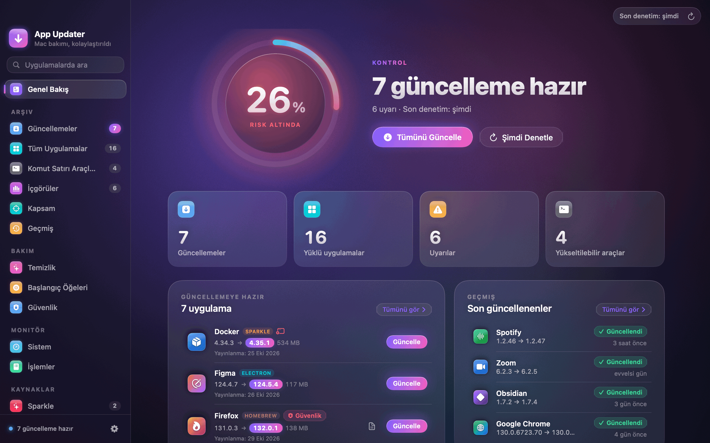
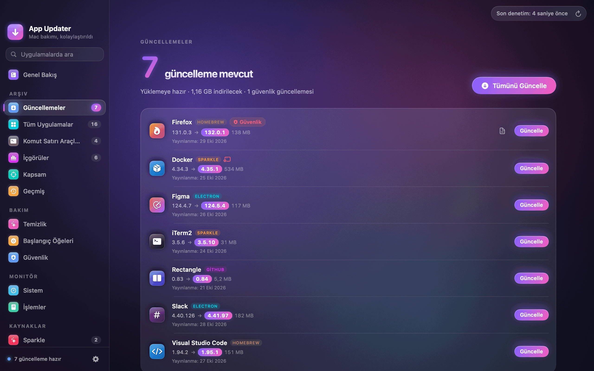
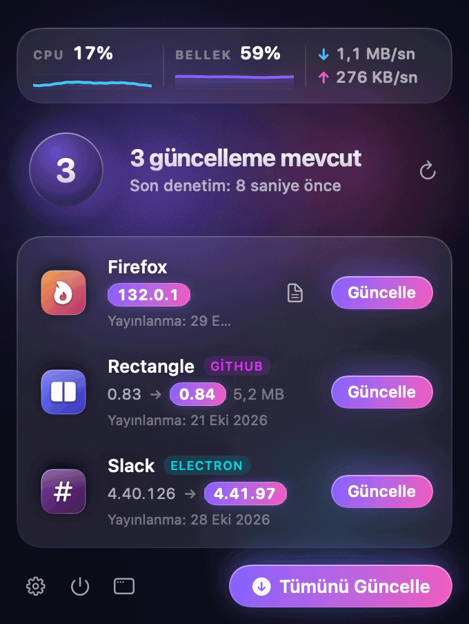
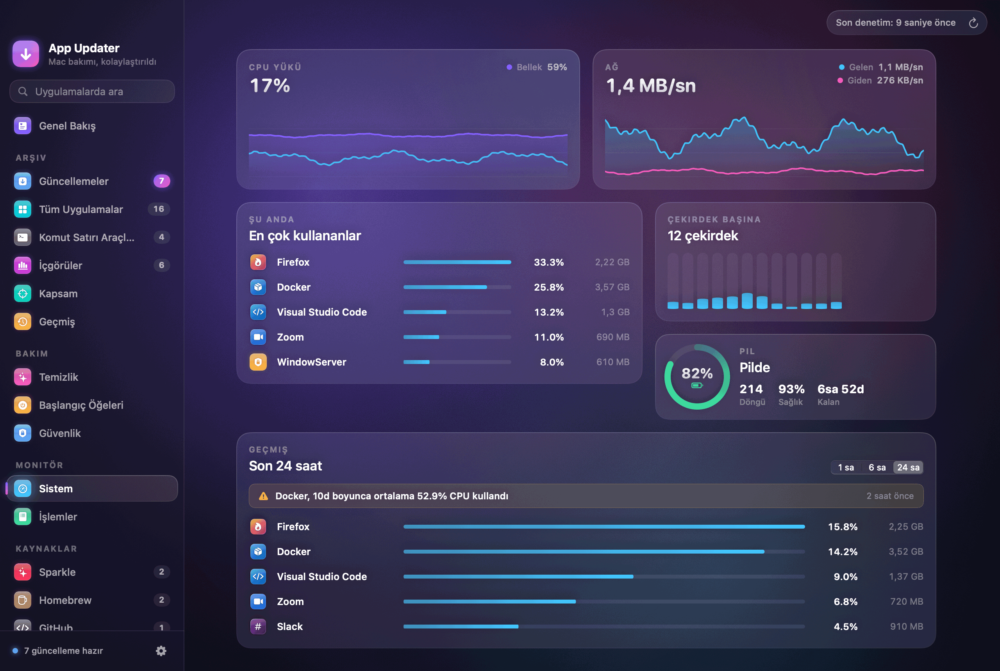
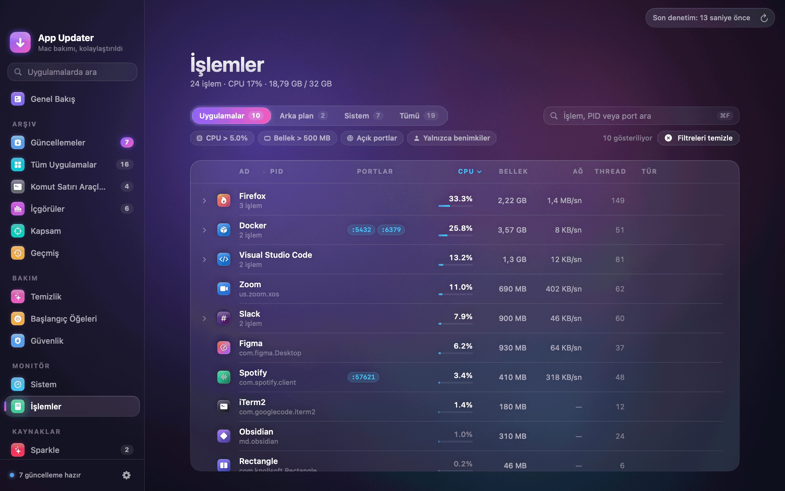
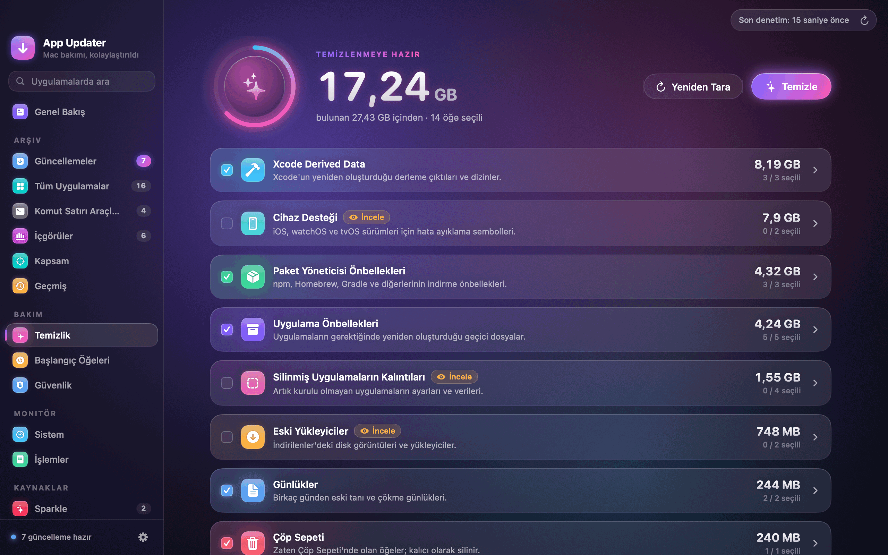
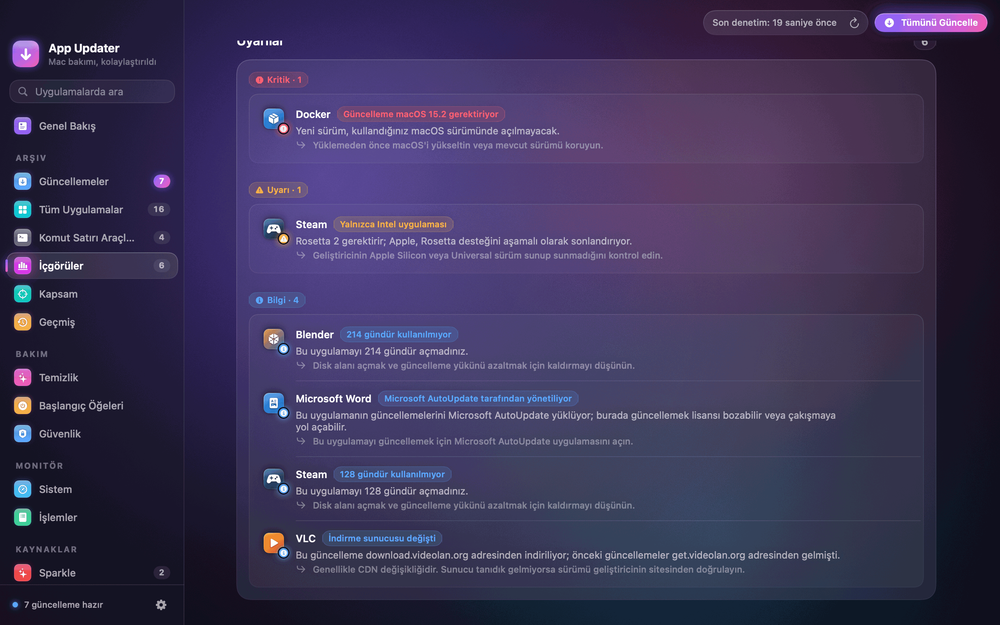

<p align="center">
  
</p>

<h1 align="center">App Updater</h1>

<p align="center">
  <b>Mac'inizdeki her uygulama güncel, her güncelleme kurulmadan önce kontrol edilmiş.</b><br>
  Altı kaynaktan güncelleme, temizlik, sistem izleme ve güvenlik kontrolü, tek bir menü çubuğu uygulamasında.
</p>

<p align="center">
  <a href="https://github.com/atak946/MacAppUpdater/releases/latest"></a>
  
  
  <a href="LICENSE"></a>
  <a href="https://github.com/atak946/MacAppUpdater/actions/workflows/ci.yml"></a>
  <a href="https://github.com/atak946/MacAppUpdater/releases"></a>
</p>

<p align="center">
  <a href="https://github.com/atak946/MacAppUpdater/releases/latest">
    
  </a>
</p>

<p align="center">
  
</p>

<p align="center">
  <a href="README.md">English</a> · <b>Türkçe</b>
</p>

---

## ✨ Kısaca

App Updater kurulu her uygulamayı bulur ve güncellemesinin nereden geldiğini tespit eder. Güncellemeleri
arka planda denetler; indirilen dosya imza, geliştirici ve notarization kontrollerinden geçmeden hiçbir şey
kurmaz. Menü çubuğunda yaşar; ana pencerede temizlik, sistem izleme ve güvenlik özeti de vardır.

<table>
  <tr>
    <td width="50%" valign="top">
      
      <h3>🔄 Güncellemeler</h3>
      App Store, Sparkle, Homebrew, GitHub, Electron ve üretici güncellemeleri tek listede; sürüm notları,
      ilerleme ve tek tıkla geri alma ile. Notlarında güvenlik düzeltmesi veya CVE geçenler en üstte.
    </td>
    <td width="50%" valign="top">
      
      <h3>📍 Menü çubuğundan</h3>
      Bekleyen güncellemeler, canlı CPU, bellek ve ağ, Tümünü Güncelle; hepsi bir tık uzakta. Zamanlanmış
      denetimler, sizin koyduğunuz kurallar içinde güncellemeleri kendisi de kurabilir.
    </td>
  </tr>
  <tr>
    <td width="50%" valign="top">
      
      <h3>📈 Sistem izleme</h3>
      Çekirdek başına CPU, bellek baskısı, disk, ağ ve pil; ayrıca en çok kaynak tüketen uygulamaların
      24 saatlik geçmişi ve sürekli yüksek CPU kullananlar için uyarı.
    </td>
    <td width="50%" valign="top">
      
      <h3>⚙️ İşlemler</h3>
      Uygulamaya göre gruplanmış işlemler; CPU, bellek, ağ ve thread sütunları. Sıralayın, filtreleyin,
      açık portlara bakın, çıkın ya da zorla kapatın.
    </td>
  </tr>
  <tr>
    <td width="50%" valign="top">
      
      <h3>🧹 Temizlik</h3>
      Önbellekler, loglar, Xcode ve simülatör verileri, paket yöneticisi önbellekleri, eski kurulum
      dosyaları, büyük dosyalar ve sildiğiniz uygulamaların kalıntıları. Hepsi Çöp'e gider.
    </td>
    <td width="50%" valign="top">
      
      <h3>🔍 İçgörüler</h3>
      En büyük, kullanılmayan ve yalnızca Intel'de çalışan uygulamalar; bozuk imza, notarization eksikliği,
      geliştirici ya da indirme adresi değişikliği ve macOS'unuzda çalışmayacak güncellemeler için uyarılar.
    </td>
  </tr>
</table>

### 🔄 Güncellemeler nereden gelir

| Kaynak | Uygulama nasıl eşleşir | Nasıl kurulur |
|---|---|---|
| Mac App Store | `Contents/_MASReceipt` | App Store açılır |
| Sparkle | `Info.plist` içindeki `SUFeedURL` | İndir, doğrula, değiştir |
| Homebrew Cask | [Cask dizininde](https://formulae.brew.sh) eşleşen `.app` | İndir, SHA-256, değiştir |
| GitHub Releases | `bundle id → owner/repo` eşlemesi | İndir, doğrula, değiştir |
| Electron | `Contents/Resources/app-update.yml` | İndir, SHA-512, değiştir |
| Üretici kaynakları | Firefox, Chrome, JetBrains IDE'leri ve diğerleri için yerleşik kaynaklar | Değiştir ya da üreticinin güncelleyicisini aç |

Bir üretici güncelleyicisinin yönettiği uygulamalar (Setapp, Adobe Creative Cloud, Microsoft AutoUpdate,
Google Keystone, JetBrains Toolbox) o güncelleyiciye bırakılır.

### 🛡️ Güvenlik baştan tasarımda

- **Yalnızca aynı geliştirici.** Güncelleme, kurulu uygulamayla aynı Developer ID takımıyla imzalanmış olmalı.
- **Notarize.** İndirilen dosyayı Gatekeeper kabul etmeli. İptal edilmiş bir sertifika kurulumu her zaman engeller.
- **Doğrulanmış indirmeler.** Yalnızca HTTPS; yayınlanan checksum'lar ve Sparkle EdDSA imzaları kontrol
  edilir, her dosya karantinaya alınır.
- **Geri alınabilir.** Her yerinde güncelleme öncesi yedek alınır ve tek tıkla geri yüklenebilir. Her
  kurulum, hata ve geri alma Geçmiş'te tutulur.
- **En az yetki.** `.pkg` güncellemeleri, yalnızca beklenen takımdan gelen notarize kurulum paketlerini
  kabul eden küçük bir yardımcıdan geçer.

Ayrıntılı tehdit modeli: [docs/SECURITY-MODEL.md](docs/SECURITY-MODEL.md) (İngilizce).

### 🧰 Dahası

- **Kurallar:** uygulama başına otomatik kurulum; bekleme süresi, sessiz saatler, güç ve ağ koşulları,
  "5.x'te kal" gibi sürüm sınırları.
- **Başlangıç öğeleri:** her launch agent ve daemon, sahibi ve imzasıyla; isterseniz kapatabilirsiniz.
- **Güvenlik kontrolü:** FileVault, güvenlik duvarı, Gatekeeper ve SIP; ayrıca kamera, mikrofon, ekran
  kaydı ve erişilebilirlik izni olan uygulamalar.
- **Kaldırma:** bir uygulamayı ve kalıntı dosyalarını Çöp'e taşır.
- **Yeni Mac:** uygulama listenizi Brewfile ya da JSON olarak dışa aktarın, yeni Mac'te eksikleri görün.
- **Kısayollar ve Spotlight:** Güncellemeleri Denetle, Tüm Uygulamaları Güncelle ve Önbellekleri Temizle.
- **Kapsam:** hangi uygulamayı hangi kaynağın izlediği, hangilerinin hiç izlenmediği.
- **Komut satırı araçları:** güncel olmayan Homebrew formülleri ve yükseltme.
- **Kurumsal Mac'ler:** BT için yapılandırma profili anahtarları, bkz. [docs/mdm](docs/mdm/README.md).

## 📦 Kurulum

1. En son **AppUpdater.dmg** dosyasını [Releases](https://github.com/atak946/MacAppUpdater/releases/latest) sayfasından indirin.
2. Açın ve **App Updater**'ı **Uygulamalar** klasörüne sürükleyin.
3. Başlatın ve macOS sorduğunda **Uygulama Yönetimi** iznini verin; diğer uygulamaları güncelleyebilmesi için gerekli.

Sürümler Apple tarafından imzalanır ve notarize edilir. App Updater kendini
[Sparkle](https://sparkle-project.org) ile günceller; her güncelleme EdDSA imzasıyla doğrulanır.

**Gereksinimler:** macOS 14 veya üzeri, Apple Silicon ya da Intel. Uygulama Türkçe ve İngilizce kullanılabilir.

## 🔐 İzinler

macOS her izni, bir özellik ona ilk ihtiyaç duyduğunda sorar. Birini reddederseniz yalnızca o özellik kapalı kalır.

| İzin | App Updater neden ister |
|---|---|
| **Uygulama Yönetimi** | Güncellemelerini kurarken diğer uygulamaları değiştirmek |
| **Bildirimler** | Yeni güncellemeler, biten kurulumlar ve çok CPU kullanan uygulamalar hakkında haber vermek |
| **Tam Disk Erişimi** (isteğe bağlı) | Güvenlik kontrolü için izin veritabanını okumak ve korumalı klasörleri temizlemek |
| **Yönetici** (isteğe bağlı) | `.pkg` güncellemeleri için yardımcıyı açmak ve sistem launch daemon'larını değiştirmek |
| **Giriş öğesi** | "Girişte başlat" |

## 🕵️ Gizlilik

- **Telemetri yok.** Analitik yok, takip yok, hesap yok.
- **Veriler yerelde.** Geçmiş, kurallar, kullanım geçmişi ve ayarlar Mac'inizde kalır.
- **Ağ istekleri güncelleme denetimidir:** uygulamaların kendi kaynakları (Sparkle, Electron, üreticiler),
  Homebrew cask dizini, eşlenen depolar için GitHub API, App Store sorgusu ve Gatekeeper'ın yaptığı Apple
  notarization kontrolü. App Updater'ın kendi güncelleme denetimi yalnızca bu projenin GitHub Releases'teki
  appcast dosyasını indirir.

## 🛠️ Kaynaktan derleme

```bash
make test   # swift test
make app    # build/AppUpdater.app, ad-hoc imzalı
open build/AppUpdater.app
```

Gereksinimler, uygulama paketi, sürüm çıkarma, mimari ve ekran görüntülerinin nasıl üretildiği
[docs/DEVELOPMENT.md](docs/DEVELOPMENT.md) dosyasında (İngilizce).

## 🤝 Katkı

Issue ve pull request'ler memnuniyetle karşılanır. Bir güvenlik açığı bildirmek için [SECURITY.md](SECURITY.md).

## 📄 Lisans

[MIT](LICENSE)
